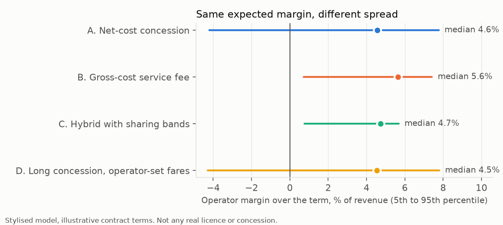
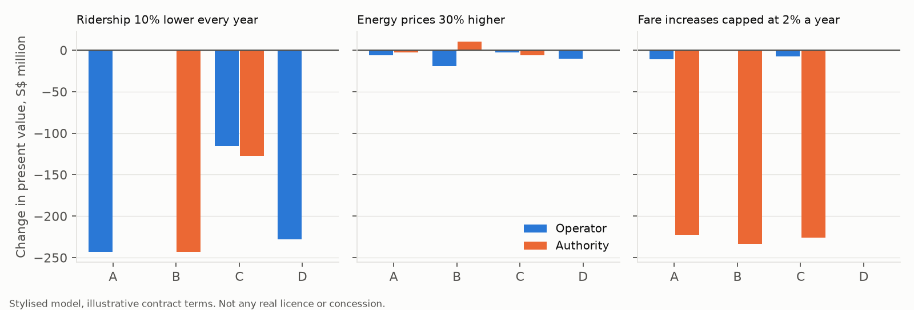
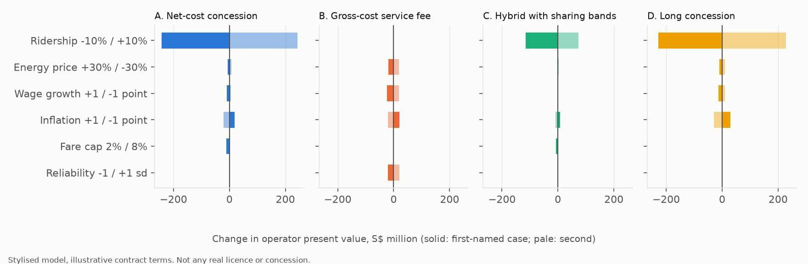
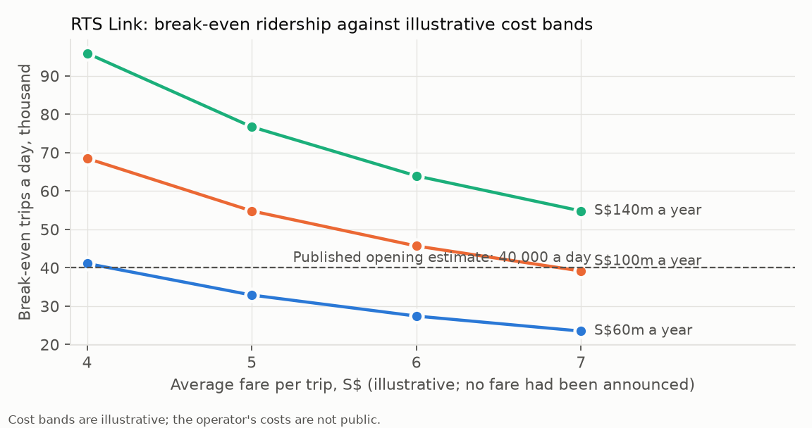
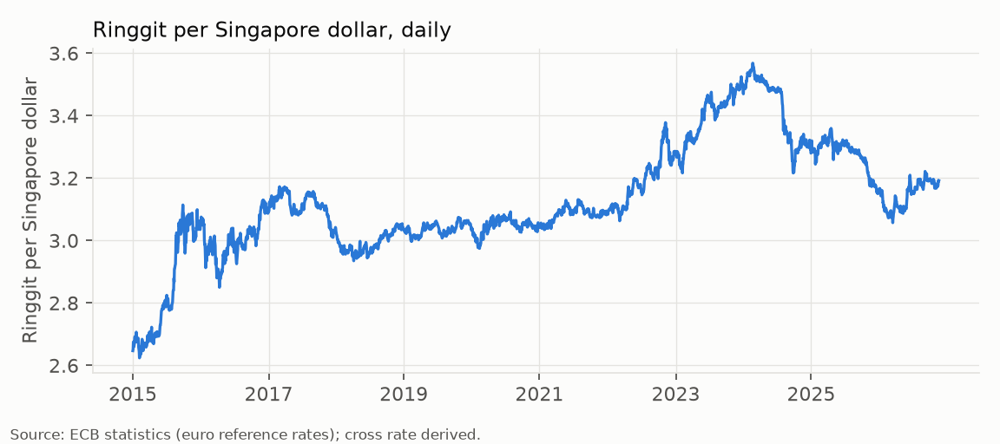

# sg-rail-commercial-arrangements

> **Read this first.** Personal portfolio project on public information, built with AI assistance. It is an
> independent desk study: not affiliated with, commissioned by or endorsed by the Land Transport Authority (LTA),
> the Ministry of Transport, any rail operator, or the Government of Singapore or of Malaysia, and it uses no
> non-public information. The contract model is **stylised and illustrative**: its terms are textbook forms and
> the author's placeholders, not the terms of any real licence or concession. Every input is labelled REAL,
> DERIVED, ASSUMPTION, ILLUSTRATIVE or SYNTHETIC in the [provenance table](#provenance).
> Author: Wenjie Luo (GitHub LUOaini1213).

<!-- Generated by scripts/build_docs.py from results/*.json and data/facts.csv. Edit docs/templates/README.md instead. -->

How should fare-revenue risk and cost risk be shared between a transport authority and a rail operator, and what
changes when the line crosses a border and the operator sets the fare? This repository approaches the question in
three steps:

1. a **fact base** of what has been said publicly about Singapore's rail operating arrangements and the Johor
   Bahru-Singapore Rapid Transit System (RTS) Link, with a quoted passage and a link for each claim;
2. a **stylised model** of four contract archetypes for one line, with a Monte Carlo simulation of who ends up
   bearing which risk;
3. **scenario arithmetic** for the RTS Link, built only on published capacity, ridership and checkpoint figures.

Readers short of time: [one-page summary](docs/one_page_summary.md), then the [policy brief](docs/policy_brief.md).

## Headline results

All money is in Singapore dollars. Model results are for a stylised line over 15 years
and 20,000 simulated paths. They describe the archetypes, not any real operator.

- **Fact base.** 81 facts from 39 sources;
  76 VERIFIED against a primary source and
  5 UNVERIFIED. 4 rows record a
  conflict or a superseded statement. See [docs/fact_base.md](docs/fact_base.md).
- **Latest dated statements found** (sources accessed 2026-11-23): RTS Link passenger
  service is expected in February 2027, subject to safety certification and regulatory approval (F72); no RTS
  fare had been published (F66, F74); the Cross Island Line operating contract was not awarded in November 2024
  and no later award was found (F25, F34).
- **Same expected margin, very different spread.** Each archetype is priced to give the operator a
  5% margin on the expected path. Across the simulations the operator
  loses money over the whole term in 24% of runs under a
  net-cost concession (A), 3% under a gross-cost service fee
  (B) and 5% under a hybrid with sharing bands (C). The
  authority's position moves the other way: the standard deviation of its present value is
  S$21m under A, S$85m
  under B and S$57m under C.
- **Ridership risk goes where the fare box goes.** A fall in ridership of one tenth costs the operator all of the
  lost surplus under A, none under B and 47% under C
  with the illustrative bands.
- **Incentives are the price of protection.** Under B the operator keeps nothing from extra ridership, so the
  contract has to buy effort through incentive payments. Under C the operator keeps
  0.53 of each extra dollar on the expected path and
  0.11 once profits are in the
  upper sharing band.
- **Who pays for deferred fare increases depends on one design choice.** Capping yearly fare increases at
  2% instead of 5% costs the
  authority S$222m in present value under A when the deferral
  is covered by subsidy, and costs the operator S$233m when it
  is not.
- **RTS Link arithmetic.** The published opening estimate of 40,000 passengers
  a day is 13% of the roughly 300,000
  travellers a day at Woodlands Checkpoint. At an illustrative S$5 fare that
  is S$73m a year. Against an illustrative yearly cost of
  S$100m, break-even needs about
  54,795 trips a day
  (137% of the opening estimate). The operator's
  real costs are not public, so this is a way of framing the question and not a finding about viability.
- **Inconvenient results.** The stylised line covers its operating cost from fares
  (1.07), while the two published loss-making years used as a
  check show 0.52 and
  0.73; the model is healthier than that history. The
  high loss probabilities under A and D come from a thin margin meeting assumed volatilities; they are a
  property of the assumptions, not evidence about any operator.

## What the public record says

The full list, with quotes, is in [docs/fact_base.md](docs/fact_base.md). The short version:

- Under the New Rail Financing Framework (NRFF), LTA owns the operating assets, and the operator collects fares
  and pays a licence charge (F01, F02). Version one had no mechanism to share a fare-revenue shortfall (F03).
  Version two shares some shortfall and takes more of the profit when results beat expectations, which LTA
  describes as effectively capping margins (F04, F05). LTA rates the operator's commercial risk as
  High / Medium under the two versions. Thresholds and rates are not published.
- Licences were shortened from over thirty years to 15 years (F12); the Downtown Line moved to version two
  under a single 11-year licence with two other lines (F08).
- The Thomson-East Coast Line runs on a service fee with the Government keeping fare revenue and bearing
  fare-revenue risk (F17 to F19). The Jurong Region Line was awarded on the same basis: nine years plus an optional two, about S$750 million for 11 years (F22), with
  incentive payments and fee deductions (F27). The Cross Island Line was tendered on that basis in 2023 (F29).
- Fares are regulated by the Public Transport Council with a published formula (F38 to F40). In 2026 the formula
  output was 5.3% (maximum allowable 14.7%) and the Council granted 7.0% (F41, F42); the Government funds the deferred part
  (F44, F47).
- The RTS Link is a 30-year first concession to RTS Operations Pte Ltd, which sets fares commercially and finances
  the operating assets, while each Government's infrastructure company funds and owns the civil works on its side
  (F63 to F66, F70).

### Mapping real arrangements to archetypes

The mapping goes only as far as the cited public descriptions. It is the author's reading, not a statement of
what any contract "is".

| Real arrangement | Closest archetype | Confidence | Facts relied on | What public sources do not say |
| --- | --- | --- | --- | --- |
| New Rail Financing Framework version one (Downtown Line, 2011 to 2021) | A | Medium | F02, F03, F09 | The licence charge had a fixed and a variable part, so it was not a pure fixed charge; amounts are not public |
| New Rail Financing Framework version two (North-South, East-West, Circle, North East and Downtown lines and the LRT systems) | C | Medium | F04, F05, F06, F08, F09 | Thresholds, sharing rates and the level of the effective margin cap |
| Thomson-East Coast Line, first nine-year period | B | High for the form | F17, F18, F19 | Size of incentives and deductions; fee indexation |
| Jurong Region Line, first licensing period | B | High for the form | F22, F26, F27 | Size of incentives and deductions; fee indexation |
| Cross Island Line | B as tendered in 2023; not awarded | Low | F25, F29, F34 | Whether a later award will keep the tendered form; no award had been announced when sources were checked |
| RTS Link (RTS Operations Pte Ltd, first 30-year concession) | D in part | Low to medium | F64, F65, F66, F70 | Whether and how payments flow between the operator and the two grantors; the payment term in archetype D is a placeholder |
| Singapore Rail Test Centre | none | Not mapped | F35, F36, F37 | No public description of an operating contract was found |

## The stylised model

One line, sized on the Downtown Line's 2025 ridership (F52), with an average fare per boarding derived from
published figures. The four archetypes, with explicit payoff functions in `railca/archetypes.py`:

- **A. Net-cost concession.** The operator keeps fare and non-fare revenue and pays a fixed licence charge.
- **B. Gross-cost service fee.** The authority keeps all revenue and pays an indexed fee, with a capped incentive
  or deduction for reliability.
- **C. Hybrid.** As A, plus the authority shares a fare-revenue shortfall beyond a deadband, and takes a share of
  profit above two margin bands.
- **D. Long concession.** The operator sets fares (they follow costs without a regulatory lag), finances operating
  assets and makes a payment to the grantors.

In every archetype, operator payoff plus authority payoff equals the system surplus; a property test checks this.
The Monte Carlo draws ridership (with a pandemic-like tail taken from the 2020 to 2023 ridership record, F50),
energy prices, wage growth and inflation, and applies the fare formula with a yearly cap so that fare increases
lag costs.

### Distribution of outcomes

Present values in S$ million. "Worst-tail average" is the mean of the worst twentieth of runs.

| Archetype | Margin: 5th percentile | Median | 95th percentile | Loss in a given year | Loss over the term | Operator worst-tail average | Authority: standard deviation |
| --- | ---: | ---: | ---: | ---: | ---: | ---: | ---: |
| A. Net-cost concession | -4.2% | 4.6% | 7.8% | 39% | 24% | -181 | 21 |
| B. Gross-cost service fee | 0.7% | 5.6% | 7.4% | 7% | 3% | -41 | 85 |
| C. Hybrid with sharing bands | 0.8% | 4.7% | 5.7% | 21% | 5% | -40 | 57 |
| D. Long concession, operator-set fares | -4.3% | 4.5% | 7.8% | 27% | 23% | -165 | 4 |



Archetype D pays for its own operating assets, so its authority column is not comparable with the others. Over a
30-year term the chance of at least one pandemic-like event at
the assumed yearly probability is 44%, and the
operator loses money over the term in 33% of runs.

### Who bears which risk

Change in present value, S$ million, operator / authority.

| Shock (one at a time, expected path) | A: operator / authority | B: operator / authority | C: operator / authority | D: operator / authority |
| --- | ---: | ---: | ---: | ---: |
| Ridership 10% lower in every year | -243 / 0 | 0 / -243 | -115 / -128 | -228 / 0 |
| Pandemic-like fall starting in year 3 | -161 / 0 | 0 / -161 | -99 / -63 | -156 / 0 |
| Energy prices 30% higher from year 1 | -6 / -3 | -19 / +10 | -3 / -6 | -10 / 0 |
| Wage growth 1 point higher each year | -9 / 0 | -23 / +15 | +1 / -10 | -14 / 0 |
| Yearly fare increases capped at 2% (deferral covered) | -11 / -222 | 0 / -233 | -7 / -226 | 0 / 0 |
| Reliability 1 standard deviation below target every year | 0 / 0 | -20 / +20 | 0 / 0 | 0 / 0 |
| Yearly fare increases capped at 2% (deferral not covered) | -233 / 0 | 0 / -233 | -80 / -153 | 0 / 0 |



Under B a rise in energy or wage costs also raises regulated fares through the formula, which is why the
authority's position improves slightly while the operator's worsens: the fee is only partly indexed.

### Marginal incentives

| State of the world | Archetype | Kept from S$1 of extra surplus from ridership | Kept from S$1 of cost saved | Gain from one standard deviation of reliability (S$m a year) |
| --- | --- | ---: | ---: | ---: |
| Expected | A | 1.00 | 1.00 | 0.0 |
| Expected | B | 0.00 | 1.00 | 1.7 |
| Expected | C | 0.53 | 0.50 | 0.0 |
| Expected | D | 1.00 | 1.00 | 0.0 |
| Ridership 20% below projection | A | 1.00 | 1.00 | 0.0 |
| Ridership 20% below projection | B | 0.00 | 1.00 | 1.7 |
| Ridership 20% below projection | C | 0.53 | 1.00 | 0.0 |
| Ridership 20% below projection | D | 1.00 | 1.00 | 0.0 |
| Ridership 15% above projection | A | 1.00 | 1.00 | 0.0 |
| Ridership 15% above projection | B | 0.00 | 1.00 | 1.7 |
| Ridership 15% above projection | C | 0.11 | 0.05 | 0.0 |
| Ridership 15% above projection | D | 1.00 | 1.00 | 0.0 |

### Sensitivities



### Procurement illustration

Two illustrative bidders, one 8% cheaper (the size of a published bid gap, F23)
and one with a higher quality score. The cheaper bidder wins until the weight on quality passes
47%. Separately, bidding a fixed fee below the calibrated level over an
11-year term:

| Fee relative to the calibrated level | Mean margin | 5th percentile margin | Loss over the term |
| ---: | ---: | ---: | ---: |
| calibrated | 5.0% | 1.3% | 3% |
| -4% | 1.1% | -2.8% | 19% |
| -8% | -3.2% | -7.3% | 100% |
| -12% | -7.9% | -12.2% | 100% |

This says nothing about any real bid: no real bidder's costs are public. It shows only that a fee discount larger
than the margin it started from has to be recovered through lower costs.

### Sanity check against published financials

| Check | Stylised line | Published figure | Comment |
| --- | ---: | ---: | --- |
| Operating cost, S$m a year | 135 | 132 | Downtown Line, 2017 (F54). Same order of magnitude; the published figure may include charges the model treats separately |
| Fare revenue, S$m a year | 145 | 69 | Downtown Line, 2017 (F54). The model is about twice as high: it uses 2025 ridership and a 2026 network-average fare |
| Fare revenue / operating cost | 1.07 | 0.52 and 0.73 | Downtown Line 2017 and SMRT Trains to March 2018 (F53, F54). The stylised line is healthier than either published loss-making year |
| Operating margin | 5.0% | 4.5% | SBS Transit group 2025, bus and rail together (F55). Close, but not a rail-only figure |

## RTS Link scenarios

Published anchors: capacity of 10,000 passengers an hour in each direction (F62),
an estimated 40,000 passengers a day on opening (F69), about
300,000 travellers a day at Woodlands Checkpoint (F77), and a
30-year first concession (F64). With an assumed
18-hour day and a peaked load profile the line could carry about
150,000 trips a day.

Fares had not been announced when the sources were checked. The fare levels below are illustrative. For
reference, the shuttle train costs RM5 from Johor Bahru (about
S$1.57) and S$5 from Woodlands for
non-Malaysians (F80); a press-reported indicative range for the RTS Link of S$5
to S$7 is UNVERIFIED (F75).

Yearly fare revenue, S$ million / RM million at the latest rate:

| Ridership scenario | Trips a day | S$4 fare: S$m / RMm | S$5 fare: S$m / RMm | S$6 fare: S$m / RMm | S$7 fare: S$m / RMm |
| --- | ---: | ---: | ---: | ---: | ---: |
| Published opening estimate | 40,000 | 58 / 186 | 73 / 233 | 88 / 280 | 102 / 326 |
| 10% of Woodlands Checkpoint volume | 30,000 | 44 / 140 | 55 / 175 | 66 / 210 | 77 / 245 |
| 20% of Woodlands Checkpoint volume | 60,000 | 88 / 280 | 110 / 350 | 131 / 419 | 153 / 489 |
| 35% of Woodlands Checkpoint volume | 105,000 | 153 / 489 | 192 / 612 | 230 / 734 | 268 / 856 |

Break-even trips a day against illustrative cost bands (share of the opening estimate in brackets):

| Illustrative yearly cost | S$4 fare | S$5 fare | S$6 fare | S$7 fare |
| --- | ---: | ---: | ---: | ---: |
| S$60m | 41,096 (103%) | 32,877 (82%) | 27,397 (68%) | 23,483 (59%) |
| S$100m | 68,493 (171%) | 54,795 (137%) | 45,662 (114%) | 39,139 (98%) |
| S$140m | 95,890 (240%) | 76,712 (192%) | 63,927 (160%) | 54,795 (137%) |



**Exchange rate.** Since 2015-01-02 the ringgit has ranged from
2.62 to 3.57 per Singapore dollar, with annualised volatility of
5.0% (ECB reference rates, cross rate derived). If half of tickets were priced
in ringgit at a rate fixed at launch, at the opening estimate and a S$5 fare:

| Exchange rate case | Ringgit per S$ | Revenue in S$m | Margin, costs half in ringgit (S$m) | Margin, costs all in S$ (S$m) |
| --- | ---: | ---: | ---: | ---: |
| Ringgit strong (5th percentile since 2015) | 2.84 | 77.5 | -28.7 | -22.5 |
| Latest | 3.19 | 73.0 | -27.0 | -27.0 |
| Ringgit weak (95th percentile since 2015) | 3.48 | 70.0 | -25.9 | -30.0 |

Costs in the same currency mix as revenue offset most of the exposure. How tickets will be priced in each
currency is not public; the half-and-half split is a placeholder.



**Time savings, kept apart from the financial case.** At an assumed S$15 an
hour and the opening estimate:

| Minutes saved per trip | Value a year (S$m) |
| ---: | ---: |
| 20 | 73 |
| 40 | 146 |
| 60 | 219 |

These are benefits to travellers, not operator revenue, and the minutes saved are assumptions.

## Limits

- Contract terms in the model are placeholders. Real sharing bands, incentive sizes, fee indexation and any
  concession payments are not public.
- Costs do not respond to ridership, demand does not respond to fares, and the drivers are drawn independently.
- The fare per boarding is backed out from one published contribution figure and is approximate.
- Operator financials used for the check are old (2017 and 2018) or cover bus and rail together.
- "None found" rows (F34, F37) are absence of evidence on one date.
- The fact base is a snapshot on 2026-11-23. The RTS Link opening and fares are moving
  targets; re-run `scripts/verify_facts.py` and re-read the sources before quoting them.

## What this repository does not show

- It does not describe the actual terms of any LTA licence, the RTS Link concession or any tender evaluation.
- It does not forecast RTS Link ridership, fares or profitability, and takes no view on what fares should be.
- It is not a recommendation to either Government.

## Provenance

29 inputs: 11 REAL, 4
DERIVED, 8 ASSUMPTION, 5 ILLUSTRATIVE,
1 SYNTHETIC.

| Input | Label | Value or range | Source or basis | Used for |
| --- | --- | --- | --- | --- |
| Line ridership | **REAL** | 470,000 trips a day | Downtown Line 2025 average (F52) | Scale of the stylised line |
| Network ridership and pandemic path | **REAL** | MRT daily ridership 2019 to 2025 | LTA statistics (F50, F51) | Pandemic multipliers; fare per boarding |
| Fare formula weights and fixed terms | **REAL** | 0.5 / 0.4 / 0.1; 0.1%; 1.1% | PTC 2023 review (F38 to F40) | Regulated fare path |
| Granted versus allowable fare increases | **REAL** | 5.0% of 14.4% (2025); 7.0% of 14.7% (2026) | PTC (F41, F42, F46) | Anchor for the fare-cap assumption |
| Operator cost structure | **REAL** | SBS Transit group 2025 cost lines | SGX filing (F55); includes buses | Cost shares |
| Published operator results | **REAL** | SMRT Trains FY2018; Downtown Line FY2017 | Parliamentary reply (F53, F54) | Sanity check only |
| Jurong Region Line bids | **REAL** | about S$750m over 11 years; 8% gap | LTA (F22, F23) | Procurement illustration |
| RTS Link capacity, opening ridership estimate, concession length | **REAL** | 10,000 an hour each way; 40,000 a day; 30 years | Joint statement, MRT Corp (F62, F64, F69) | RTS scenarios |
| Woodlands Checkpoint volume | **REAL** | about 300,000 travellers a day | ICA (F77) | RTS ridership shares |
| Shuttle Tebrau fares | **REAL** | RM5; SGD5 | KTMB (F80) | RTS fare benchmarks |
| Euro reference rates for SGD and MYR | **REAL** | daily, 2015 onwards | ECB statistics, reuse permitted with attribution (F81) | Exchange-rate sensitivity |
| Average fare per boarding | **DERIVED** | computed | PT Fund contribution / 30% / 7.0% / rail boardings (F45, F42, F51) | Fare revenue of the stylised line |
| Cost shares | **DERIVED** | computed | SBS Transit group cost lines / total (F55) | Split of operating cost |
| Pandemic ridership multipliers | **DERIVED** | computed | MRT ridership 2020 to 2023 / 2019 (F50) | Tail scenario |
| Ringgit per Singapore dollar | **DERIVED** | computed | EUR/MYR divided by EUR/SGD (ECB) | Exchange-rate sensitivity |
| Operating cost of the stylised line | **ASSUMPTION** | S$135m a year | Author; compared with F54 | All archetypes |
| Non-fare revenue | **ASSUMPTION** | 8% of fare revenue | Author | All archetypes |
| Growth, volatility and correlation settings | **ASSUMPTION** | see railca/params.py | Author | Monte Carlo |
| Pandemic probability | **ASSUMPTION** | 2% a year | Author | Monte Carlo tail |
| Cap on yearly fare increase | **ASSUMPTION** | 5% | Author, anchored on F42 and F46 | Fare-adjustment lag |
| Discount rate, target margin | **ASSUMPTION** | 4%; 5% | Author | Calibration and present values |
| Value of travel time, minutes saved | **ASSUMPTION** | S$15 an hour; 20 to 60 minutes | Author | RTS time savings (kept apart from the financial case) |
| RTS operating hours and peak profile | **ASSUMPTION** | 18 hours; 4 peak hours | Author; hours are not yet announced (F76) | Capacity ceiling |
| Sharing bands, deadband, incentive and penalty sizes, fee indexation | **ILLUSTRATIVE** | see railca/params.py | Not public (F04, F05, F27) | Archetypes B and C |
| Capital charge, concession payment | **ILLUSTRATIVE** | S$8m a year; solved | Not public | Archetype D |
| RTS operator cost bands | **ILLUSTRATIVE** | S$60m, S$100m, S$140m a year | Not public | RTS break-even |
| RTS fare scenarios | **ILLUSTRATIVE** | S$4 to S$7 | Benchmarks F80; press range F75 (UNVERIFIED) | RTS revenue |
| Bidder quality scores and prices | **ILLUSTRATIVE** | see railca/procurement.py | Author | Procurement illustration |
| Simulated paths | **SYNTHETIC** | 20,000 draws | Seeded generator | Monte Carlo |

Source pages are not redistributed. `data/sources_manifest.csv` lists each URL with its size, checksum and access
date, and `scripts/verify_facts.py` re-opens every page and checks that each quoted passage is still there. The
exchange-rate file is an unmodified extract of ECB statistics, reused under the ECB's reuse policy (F81).

## Reproduce

```
python -m venv .venv
.venv/Scripts/python -m pip install -r requirements.txt     # or .venv/bin/python
python scripts/run_all.py            # results/*.json, the workbook, figures (offline)
python scripts/build_docs.py         # README and docs from templates
python -m pytest -q                  # 69 tests, offline
python scripts/mutate.py --record final
python scripts/verify_facts.py       # needs network: re-opens every source
```

The Excel workbook `results/rail_contract_model.xlsx` holds the expected-path model for the four archetypes and
a ridership-by-cost scenario grid as live formulas. A test evaluates
1,052 formula cells with the `formulas` package and compares
633 of them with the Python model.

Mutation testing: 0 of 0 hand-written mutants
are killed by the test suite (0 of 0 on the first
run; see `results/mutation.json`).

## Layout

```
data/        facts.csv, sources_manifest.csv, arrangement_mapping.csv, ECB exchange-rate extract
railca/      archetypes (payoffs), paths (drivers), analysis, rts, procurement, workbook, params
scripts/     run_all, build_docs, verify_facts, fetch_fx, mutate
docs/        policy brief, one-page summary, fact base, templates
results/     JSON results and the Excel workbook
figures/     charts
tests/       pytest suite
```

## Licence

MIT. See [LICENSE](LICENSE).
